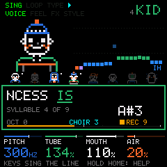
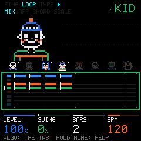
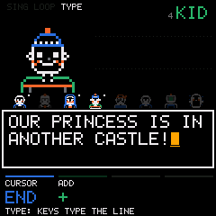

# MUMBLE

Retro-game characters that sing what you type: a firmware for the M-VAVE FM-1. The whole FM-1 becomes MUMBLE.
Eight characters sing one line of text a syllable at a time, from formant synthesis (no recordings). Type a line,
sing it on the keys with the choir on chords, and record what is sung into a multitrack loop that sings whatever the
line says now.

  

- **[Try it in the browser](https://kdziamura.github.io/fm1-mumble/emu/)**: the same code as the FM-1, with sound,
  played with a mouse or your computer's keyboard.
- **[Install it](https://kdziamura.github.io/fm1-mumble/install/)** from Chrome or Edge, the FM-1 connected by USB.
- **[Releases](https://github.com/kdziamura/fm1-mumble/releases)**: each one's package (`mumble-X.Y.fwsc`), built
  and signed on GitHub from its source, with what changed.

You install it at your own risk. Back up the FM-1 first; M-VAVE's own firmware goes back on the same way.

## Install

The [web installer](https://kdziamura.github.io/fm1-mumble/install/) writes the release's package and can put
M-VAVE's firmware back. Any FM-1 installer that takes a `.fwsc` works too: M-Flasher, the Firmware Hub, or from a
terminal `base/tools/fm1_install.py mumble-0.1.fwsc` (needs `mido` and `python-rtmidi`). fm1-base's update loader
accepts both flash chips (`0x856014` and the newer UC25HQ80 `0xB36014`), and the firmware updates from itself, so
another firmware or M-VAVE's own goes back on the same way. GLO's system screen shows the version installed. Over
USB the FM-1 shows up as **MUMBLE FM-1**, a USB MIDI device.

**Your saves and other firmwares.** MUMBLE does not read what other firmwares saved, and they do not read MUMBLE's.
It keeps its line, voices and loop in the FM-1's flash at `0xFC000` and `0xDC000`, where other firmwares often keep
theirs: it ignores anything there that is not its own, and its first save writes over it. Back up the firmware you are
on before you switch (each firmware's own backup, or M-Flasher's full one).

## Controls

Hold **HOME** for a card of these on the screen; every button also says on the hint line what it just did.

Each character's face is built from their voice, and changes with it: the head's proportions follow its size,
pitch and effort, and what stands out in the voice against the rest of the cast picks the parts (a hood for ROOM, an
antenna for RADIO, a beanie for a high voice, a knight's helmet for a drilled one, a beard for WOBBLE, a robot for
CRUSH, a ghost for AIR ...); `tools/faces.py` draws the same faces into contact sheets. LFO's rolled voice gets a new
face.

Everything you make is kept over power-off: the line, each character's sound, choir and level, the loop and its
size, the scale and its root, the arpeggiator and auto-chord. It saves itself 3 s after the last change, once the FM-1 has been quiet for
a second (the loop stopped, nothing sounding or held): writing the flash holds the whole FM-1 for a moment, so it
never happens during a performance. Change something while the loop plays and it is saved when you stop.

The band is spread across the stereo field: those who sing (the choir, and anyone with unmuted notes in the loop), in
the cast's order, each in the middle of their share of it. One alone is in the middle, two at a quarter and three
quarters, three at a sixth, a half and five sixths, and so on, gliding there as the band changes. The shared echo and
room duck under the voices, so they fill the gaps rather than blur the singing; a rolled voice adds only a little of
either, and hardly any WOBBLE. SPEED sets how fast a character talks in TYPE and how fast their WOBBLE goes (2 Hz at
100 %). Consonants are bright and crisp before a vowel, a percussive attack, and softer as an
ending; in a chord only the leading singer sings them, the others the vowel alone.

The loop follows a MIDI clock from USB or the TRS jack: Start starts it from the top on the clock, its tempo sizes it
(LOOP shows SYNC), Stop stops it; without a clock it keeps its own BPM.

The first boot (and a reset) gives the line "Our princess is in another castle!", yours to change or clear.

PRESET turns between three modes: **SING** (the keys sing the line; the mode at boot), **LOOP** (the multitrack view: a
lane of the loop for each character, the keys singing as in SING) and **TYPE** (the keys type the line). ALGO turns
SING's sound pages and LOOP's tabs. In TYPE the keys' lights mark the vowels; in SING and
LOOP a key is lit while it is held.

| Control | SING | LOOP | TYPE |
|---|---|---|---|
| Keys | Sing the line a syllable at a time; held keys make a chord | As in SING | Type at the cursor |
| SELECT | The character | | |
| PRESET | The mode: SING (at boot), LOOP, TYPE | | |
| ALGO | The sound page the knobs play: VOICE, FEEL, FX, STYLE (tabs at the top) | The tab the knobs set: MIX, ARP, CHORD, SCALE (tabs at the top) | — |
| K1–K4 | The page's four sounds, shown with a bar of where each sits and a tick at the character's own | MIX: the character's level (0: muted), swing, bars, BPM. ARP: rate (1/4 .. 1/32, triplets), pattern (up, down, up-down, random, as played), octaves (1-3), gate (10-100 %). CHORD: the shape (triad, 7th, power, sus2, sus4, add9), inversion, spread (close, open, wide). SCALE: the root (C .. B), the scale | K1 the cursor, K2 the letter under it (at the end: a new one) |
| EDIT | The selected character's notes out of the loop; held 1 s: clear the loop. Held with a knob turned: that setting back | As in SING | A word back; held 1 s: clear the line, then the loop |
| OCT- / OCT+ | Octave down / up | As in SING | Delete / CAPS (shouted words) |
| FX | Back to the top of the line | As in SING | The cursor to the line's start |
| SCL | The next scale (major, minor, pentatonic, blues, dorian, mixolydian, harmonic minor; SCL lit) the keys keep to | | |
| LFO | A new voice rolled for the selected character; held 1 s: for everyone | As in SING | A random syllable at the cursor (however long it is held) |
| ENV | The selected character's own voice back; held 1 s: everyone's | | |
| ARP | The arpeggiator on or off (ARP lit; LOOP's ARP tab sets it): the keys held sung one at a time in the pattern (on the loop's time while it runs), round the choir, a syllable each | As in SING | On or off, for SING and LOOP |
| SEQ | Auto-chord on or off (SEQ lit; LOOP's CHORD tab sets it): a key sings a chord built up the scale (no scale: major on the root), a note a singer: as many of its notes, from the root up, as the choir has singers (one alone: the root) | As in SING | On or off, for SING and LOOP |
| GLO | The system screen, open or closed: the audio's load (now and the most since boot), dropouts, the battery, how long the FM-1 has been on, the MIDI clock. There EDIT tapped, then held 3 s, resets everything to the first boot | | |
| SAVE | The character in or out of the choir | | |
| PLAY / REC | The loop on or off / record into it (from TYPE: to SING first). With the loop stopped REC waits, blinking, with the metronome counting the tempo, and the first key starts the loop and the recording | | |

## Development

MUMBLE is built on [fm1-base](https://github.com/charlesvestal/fm1-base) (MPL-2.0, pinned as the `base/` submodule),
which runs on JieLi's open AC79 SDK and its Linux toolchain, with a 581 KB app slot. `app/engine.c` builds the voice
engine (`app/mumble.c`) as an -O2 unit, and `app/app.c` includes the page (`app/mumble_screen.inc`) and gives it the
panel's controls, its painting (`app/paint.inc`) and the frame loop.

| Path | What |
|---|---|
| `app/app.c` | The app's contract with fm1-base (`app_init`, `app_render`, `app_frame` ...) and the controls adapter |
| `app/mumble.c`, `app/mumble.h` | The voice engine: text to syllables, the glottal source, formants, consonants, the choir, the loop, effects and the master compressor |
| `app/mumble_screen.inc` | The page: SING, LOOP and TYPE, the choir, recording, the knob pages |
| `app/mumble_faces.inc`, `app/mumble_sprites.inc` | The cast's faces, built from their voices (portrait, icon, the rig that talks and blinks), and their palette |
| `app/paint.inc` | The damage-marking painter on fm1-base's `lcd_blit`, two band buffers in turn (adapted from FM1 Open, see `NOTICE.md`) |
| `app/engine.c`, `app/mumble_port.h` | The engine as an -O2 unit; its audio path runs from RAM (`PLAT_RAM_CODE`) |
| `app/fm1.toml` | Build settings: name, package identity `FM-1_68`, USB MIDI only; the site's and firmware.json's name, author, description, links and screenshot |
| `app/tests/basic.txt` | Host simulator script: the first line, typing the shared line, SING, the loop and LOOP mode's lanes; screenshots and a WAV |
| `app/tests/line.txt` | Host simulator script: SING mode on a typed line, keys sharing the leading key's syllable, moving on after it, round the line, FX; a recorded note singing a new line typed while the loop plays; each pass from the line's top |
| `app/tests/controls.txt` | Host simulator script: TYPE's cursor and letter knobs, EDIT a word back and held to clear, HOME's help card, EDIT with a knob putting a sound back, LOOP mode's knobs; screenshots of each |
| `app/tests/save.txt` | Host simulator script: a line, a sound, a scale, a recorded loop, a mute and a tempo saved on their own and back after a reboot |
| `app/tests/clock.txt` | Host simulator script: MIDI clock: Start, the loop on the clock's tempo as it changes, Stop, the clock gone |
| `app/tests/screens.txt` | Host simulator script: the screenshots in `app/site/img` (the README, the site, the hubs' card) |
| `app/tests/record.txt` | Host simulator script: a character as a mono synth, a chord shared out across the choir, recording per singer and playback, the metronome, EDIT clearing a singer, then the loop |
| `tests/engine_test.c`, `tests/engine.sh` | The engine's host test: text analysis, timing, chords, the loop, the compressor, consonants, the voice's spectrum |
| `tools/faces.py`, `tests/faces.sh` | The face generator in Python, for contact sheets (the cast by hand and from their voices, each setting swept, rolled voices, the rig); the check that the firmware's draws the same pixels |
| `tests/fuzz.c`, `tests/fuzz-seeds/` | libFuzzer harness and property checks over the app as the device builds it |
| `app/site/landing.md`, `app/site/img/` | The site's front page and its pictures |
| `build.sh`, `tests/run_tests.sh` | The build (fm1-base's `tools/build.py` on `app/`) and every test but the fuzzer |
| `.github/workflows/` | `mumble-fm1.yml` tests and builds every push; `release.yml` builds, signs and publishes a tagged release; `site.yml` puts it on the site |
| `firmware.json` | The firmware described for hubs and installers (written by the build from `app/fm1.toml`) |
| `fmhub.json` | The Firmware Hub's card: its text, author, kind, the demo's link, the picture and colour (hand-written; the hub rereads it every three hours) |
| `base/` | fm1-base, with felucca-bsp in `base/bsp/` |

### Build and test

The JieLi toolchain is Linux x86-64 only. On GitHub, `.github/workflows/mumble-fm1.yml` runs the tests and the
fuzzer and builds the package on every push to `main`; the run's **mumble-fm1** artifact has `mumble.fwsc`, its
checksum, the test screenshots and a recording.

Locally (Linux x86-64; on a Mac the build runs the toolchain in Docker, see fm1-base's README):

~~~sh
git submodule update --init --recursive
base/tools/setup_toolchain.sh --only jieli,ac79-sdk,uv,python   # pinned, checked downloads into base/.toolchain
tests/run_tests.sh                       # the engine, the faces, the host simulator's scripts (any cc, no toolchain)
./build.sh                               # app/build/mumble.fwsc, a dev build (version DEV)
./build.sh --host                        # the host simulator alone, then for example:
app/build/host/mumble_host app/tests/basic.txt app/build/host
app/build/host/mumble_host app/tests/screens.txt app/site/img   # the screenshots, after a change to the screen
./build.sh --web                         # the browser emulator: app/build/emu/ (Emscripten)
tests/engine.sh app/build/engine         # the engine's tests, a WAV per character
~~~

### Fuzzing

`tests/fuzz.sh` builds `app/app.c`, `app/paint.inc` and the engine with clang, ASan and UBSan on a stand-in
platform and plays each fuzz input as a performance from a fresh boot (the app's state is put back between inputs, so
a crash file replays alone: `app/build/fuzz/mumble-fuzz CRASHFILE`). Besides memory errors and undefined behaviour it
fails when a blit leaves the screen or its band buffer, a band buffer changes while its DMA is still sending it, the
incremental redraw differs from a full repaint, the state left alone 3 s is not saved or a power-off loses it, an LED names a control the FM-1 lacks, HOME leaves the page, sound
outlasts a panic by 3 s, or the same input plays differently twice. After every frame it also checks the page's
state: each field in its range and agreeing with the others and the lights (S1), and the frame's change against a
model of the controls (S2: REC flips the loop, GLO steps the mode, SELECT, PRESET and ALGO move by their detents, a knob moves
its parameter by the accelerated amount, typing adds exactly the keys' letters, only SAVE/EDIT+key touch a pad, and
with nothing pressed or turned no setting changes). Putting the state back needs the app's globals in
sections of their own, which ASan does not guard, so `tests/fuzz.sh --replay` also runs each seed and corpus input
alone in a build whose globals it does guard. CI runs the seeds, two minutes of fuzzing and that replay; a failure there is shrunk and printed as the panel
actions that make it.

~~~sh
tests/fuzz.sh -max_total_time=600 -jobs=8       # clang with libFuzzer; corpus and crashes in app/build/fuzz/
tests/fuzz.sh --replay                           # the seeds and the corpus, ASan on the globals too
tests/fuzz.sh --minimize app/build/fuzz/crashes/crash-…   # a failure shrunk (libFuzzer's minimizer), then explained
tests/fuzz.sh --explain FILE                     # an input as the panel actions it plays: "48 ms  press GLO" …
tests/fuzz.sh --merge                            # the corpus shrunk to the fewest inputs with the same coverage
~~~

### Versions and releases

Versions are `X.Y` (`X.Y.Z` for a fix, `X.Y-beta1` for a prerelease). A release build (`./build.sh --release 0.1`)
makes `mumble-0.1.fwsc` with the package identity `FM-1_68000100` (fm1.toml's `id_prefix` and the version's digits),
which installers check, and the version string the FM-1 reports and the system screen shows; a dev build is
`FM-1_6800` and `DEV`.

Releases are made on GitHub, with nothing to tag or write by hand:

1. **Releases > Draft a new release**, and in **Choose a tag** type a new one, `v0.1` (GitHub makes the tag on
   `main`). For a beta, `v0.2-beta1` and tick **Set as a pre-release**.
2. **Generate release notes** (GitHub lists the changes since the last release), and **Publish release**.

Publishing runs `.github/workflows/release.yml`: the shared FM-1 builder
([`zvenson/fm1-build`](https://github.com/zvenson/fm1-build)) builds that tag, runs `tests/run_tests.sh`, signs
build provenance for the package, the app, the `.rfm1` (for host apps such as RemoteFM1) and `firmware.json` (the
Firmware Hub shows such packages as built from source) and attaches them to the release, a few minutes later. Their
signatures are checked, then `.github/workflows/site.yml` makes the site from that attested package with fm1-base's
`tools/make_site.py` (the front page `app/site/landing.md`, the emulator, the installer, the screen reader's words)
and deploys it to GitHub Pages; the repository's Pages source must be **GitHub Actions**. A release whose tag is not
a version, or whose build, tests or signatures fail, is turned back into a draft: fix it and publish the draft again.

`firmware.json` at the root describes the firmware for hubs and installers (its name,
author, licence, description, tags, links and screenshot, from `app/fm1.toml`); the build rewrites it, so commit it
when it changes.

[The Firmware Hub](https://thefirmwarehub.com/submit/) lists a firmware with its source public under an open licence
(`LICENSE`), a GitHub release with the `.fwsc` and the update loader in it, an identity of its own (`FM-1_68`: no
other firmware's starts so), testing on a real FM-1 (installed from M-VAVE's V15 and from another firmware, and left
again) and `fmhub.json`, its card. It picks up each new release by itself; a 0.x version shows as beta. The hub runs no tests of its own,
so before sending it, test the release's very `.fwsc` on a real FM-1 as its
[knowledge base](https://thefirmwarehub.com/kb/#listed) asks:

- install it from M-VAVE's V15 and from another custom firmware: both end with MUMBLE running, and the hub names it
  after Connect;
- leave it again: with MUMBLE running, install another firmware (MUMBLE must start the next package's update loader);
- USB: it shows up as a MIDI device (**MUMBLE FM-1**: a name the hub's installer finds, as it has "FM-1" in it) and
  answers the identity request with `FM-1_68000100`;
- an interrupted update: unplug once while it says Writing, plug in again and press Install: it should continue;
- before publishing, it can boot in Simon Johansson's
  [fm1-emulator](https://thefirmwarehub.com/kb/#try) (`./emulator mumble-0.1.fwsc`), the real package on an emulated
  FM-1.

To list
MUMBLE, send the form on that page once the release is tested; check `fmhub.json` at
<https://thefirmwarehub.com/kb/#fmhub> after a change.

## Status

Played on an FM-1 (November 2026): one shared line, TYPE and SING, the choir, the recorded loop (pitches, timing and
syllable slots, singing the line as it is), consonants, glides and the master compressor.

Tested in the simulator and the fuzzer, not yet on an FM-1: the faces built from the voices, LOOP mode, the friendlier controls, the scale lock, the
arpeggiator, quantized recording, the typewriter, saving, and the MIDI clock (whose timing on the device rests on
`midi_stamp`).

The last measured device build (with consonants and glides, before the voice's top; CI, November 2026): app image
112,024 B of the 581 KB slot; RAM `.data`+`.bss` 73,568 of 98,304 B; RAM code 15,400 of 32,768 B; pool 84,484 of
344,064 B. The package `mumble.fwsc` is 616,059 B. Not yet:

- **Bluetooth MIDI is off**, and no MIDI notes come in (only the clock).

## License

GPL-3.0-only with an additional permission: the licence is in `LICENSE`, the permission and the code adapted from FM1 Open in `NOTICE.md`.
