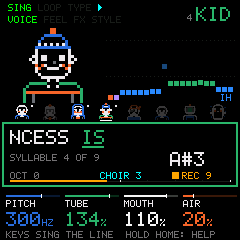
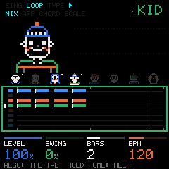
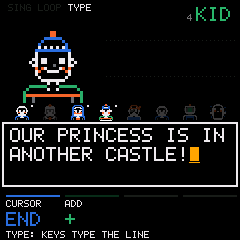

# MUMBLE

Retro-game characters that sing what you type. MUMBLE turns the M-VAVE FM-1 into a choir of eight pixel characters
who sing one line of text a syllable at a time, made from formant synthesis, with no recordings. Type a line, sing
it on the keys with the choir on chords, and record it into a multitrack loop.

This is version {{VERSION}}. You install it at your own risk, and the installer can put M-VAVE's own firmware back.

- **[Try the demo](emu/)** right here in your browser, with sound. It runs the same code as the FM-1, so you don't
  need one: play the keys with the mouse or your computer's keyboard.
- [Install](install/) it from Chrome or Edge, with the FM-1 connected by USB.
- [Download {{PKG}}](firmware/{{PKG}}) for M-Flasher, the Firmware Hub or the command-line installer
  (`python3 tools/fm1_install.py {{PKG}}` in fm1-base).
- The [Source](https://github.com/kdziamura/fm1-mumble) is under GPL-3.0, with its README on every control. It's
  built on fm1-base and felucca-bsp, which come from Felucca by Leo Kuroshita, Hügelton Instruments.

## Three modes

SELECT turns between them; ALGO turns SING's sound pages and LOOP's tabs, and PRESET picks the character.

**SING**: the keys sing the line, a syllable a key at the key's pitch. Hold several and the choir sings a chord;
SAVE puts the character in the choir. SEQ builds chords up the scale, ARP sings the keys held one at a time, SCL keeps
to a scale. K1 to K4 shape the voice: pitch, tube, mouth, air, and on the next pages feel, effects and style. LFO
rolls a new voice, and with it a new face.

**LOOP**: REC records what is sung, pass over pass, a lane for each singer. The notes keep their pitch and time, not
the words, so type a new line and the loop sings that. The tabs set the mix, the arpeggiator, the chords and the
scale, and the loop follows MIDI clock.

**TYPE**: type the line on the keys and hear the character say it as you type. EDIT takes a word back; held, it
clears the line.

Hold HOME on the FM-1 for a card of the controls. Everything you make is kept over power-off.

M-VAVE and FM-1 are trademarks of their owners. MUMBLE is not affiliated with M-VAVE.
